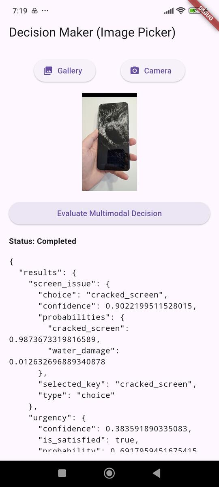

# Flutter MediaPipe Multimodal Decision Maker Example

A Flutter example application demonstrating how to natively integrate the Android [MediaPipe Multimodal Decision Maker SDK](https://developers.google.com/edge/mediapipe/solutions/decision/decision_maker/index) into Flutter using `jnigen`. 

This project evaluates complex JSON routing schemas and multimodal inputs (Text + Image) entirely on-device using edge foundation models like EmbeddingGemma 2.

## Screenshot


## Features

* **Native JNI Integration:** Zero-platform-channel overhead using `jnigen` to bind directly to the Android MediaPipe SDK.
* **Multimodal Evaluation:** Combines text prompts and images (via `image_picker`) to answer complex, schema-driven questions.
* **Kotlin DSL Bridge:** Utilizes a lightweight Kotlin wrapper to seamlessly expose MediaPipe's Kotlin-first DSL and data classes to Dart.
* **On-Device ML:** Runs 100% locally using EmbeddingGemma 2 Text Vision 440M LiteRT-LM model.

## Prerequisites

* Flutter SDK (3.x+)
* Android minSDK 24 or higher
* EmbeddingGemma 2 Text Vision 440M [ `embedding_gemma2_text_vision`](https://developers.google.com/edge/mediapipe/solutions/decision/decision_maker/index#models) LiteRT model.

## Project Setup

1. **Clone the repository:**
   ```bash
   git clone https://github.com/IoT-gamer/flutter_decision_maker_example
   cd flutter_decision_maker_example
   ```

2. **Download the Model Asset:**
    Download `embeddinggemma-2-text-vision-440m.litertlm` from [Hugging Face](https://huggingface.co/litert-community/embeddinggemma-2-text-vision-440m-litert-lm) and place it in the Android assets directory:
    ```
    android/app/src/main/assets/embeddinggemma-2-text-vision-440m.litertlm
    ```
3. **Install Dependencies:**
    ```bash
    flutter pub get
    ```
4. **(Optional) Regenerate JNI Bindings:**
If you modify the underlying Kotlin bridge (`DecisionMakerBridge.kt`), re-compile the Kotlin classes and regenerate the Dart bindings:
    ```bash
    # Build the Kotlin class files first
    flutter build apk --debug

    # Generate Dart bindings
    dart run tool/jnigen.dart
    ```
    *If the `DecisionMakerBridge` class cannot be found, you may need to modify `classPath` in `tool/jnigen.dart`. To find the correct paths, you can check your `build` directory after a successful build. In macOS/Linux run: `find build/app -name "DecisionMakerBridge.class"`*

5. **(Optional) Download damaged smartphone images to your phone**
    * For example: [Cracked & Intact Smartphone Images Dataset](https://www.kaggle.com/datasets/axondata/cracked-and-intact-smartphone-images-dataset?resource=download)

6. **Run the App:**
    ```bash
    flutter run
    ```

## Understanding the JSON Schema (`questionsSchema`)
The MediaPipe Decision Maker SDK supports evaluating multiple questions simultaneously by passing a structured JSON schema. This allows you to extract complex, typed data from unstructured text and images in a single inference call.

for this example, in `lib/main.dart`, the `_questionsSchema` is defined as:
```JSON
{
  "questions": {
    "screen_issue": {
      "type": "choice",
      "instructions": "Classify the hardware issue visible in the photo.",
      "criteria": {
        "cracked_screen": "Physical glass crack or shattered OLED panel.",
        "water_damage": "Liquid corrosion or condensation."
      }
    },
    "urgency": {
      "type": "boolean",
      "condition": "The device is inoperable or poses a physical safety risk."
    }
  }
}
```
### Schema Field Breakdown:
* `type:` Defines the expected answer format. Supported types are `choice` (categorical classification), `boolean` (true/false conditions), and `score` (ranking/rubric evaluation).
* `instructions:` Provides the LLM with context on what you are trying to determine.
* `criteria` (for `choice`): A key-value map defining the possible categories. The keys (e.g., `cracked_screen`) are what the model will output, and the values describe exactly what constitutes that category.
* `condition (for boolean):` A direct statement for the model to evaluate as true or false based on the multimodal input context.

When you pass this schema to the evaluateMultimodalJson bridge method, the SDK processes the image and the user prompt, then returns a JSON response perfectly matching the structure of your schema containing the predicted keys, boolean values, and confidence probabilities.


## Architecture
This project avoids standard Flutter MethodChannels in favor of direct JNI calls via `jnigen`.

1. `android/app/src/main/kotlin/.../DecisionMakerBridge.kt`
A minimal Kotlin class that initializes the `DecisionMaker` using its native Kotlin DSL and exposes a single `evaluateMultimodalJson` endpoint.

2. `tool/jnigen.dart` & `lib/src/generated/decision_maker_bindings.dart`
Configuration and auto-generated Dart bindings that allow Flutter to instantiate the Kotlin bridge and call its methods synchronously.

3. `lib/decision_maker_service.dart`
The Dart service class that fetches the cached Android Application Context, manages the JNI bridge lifecycle, and handles byte conversions.

4. `lib/main.dart`
The presentation layer featuring image_picker for capturing test inputs and displaying the schema-validated JSON output.

## License
This project is licensed under the MIT License - see the [LICENSE](LICENSE) file for details.

## Acknowledgments
This example was based on [Decision maker guide for Android](https://developers.google.com/edge/mediapipe/solutions/decision/decision_maker/android)